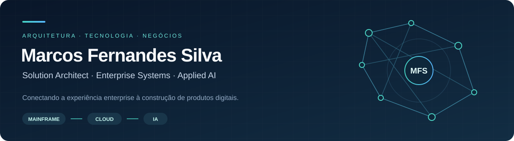

  

  <strong>Senior IT Specialist na IBM · Arquiteto de Soluções · Investidor anjo</strong> 
  São Paulo, Brasil · <a href="https://www.linkedin.com/in/marcosfernandessilva1975/">LinkedIn</a>

## Sobre mim

Atuo em tecnologia desde **1997**, com experiência em ambientes corporativos de missão crítica, infraestrutura enterprise, middleware e integração. Hoje sou **Senior IT Specialist na IBM**, trabalhando com arquitetura, sustentação e evolução de plataformas que exigem disponibilidade, desempenho e segurança.

Conecto a experiência em **mainframe e ecossistema IBM** à construção de soluções **cloud-native, orientadas a dados e inteligência artificial**. Gosto de transformar requisitos de negócio em arquiteturas claras, aplicações úteis e operações confiáveis.

Também atuo como **investidor anjo em startups de tecnologia em estágio inicial**, contribuindo com experiência técnica em arquitetura, IA e desenvolvimento de produtos digitais.

## Áreas de atuação

| Frente | Experiência e foco |
| --- | --- |
| **Arquitetura e modernização** | Arquitetura de soluções, ambientes híbridos, integração de sistemas e modernização de aplicações. |
| **Plataformas IBM** | WebSphere Application Server, Liberty, IBM MQ, MobileFirst, Sterling B2B, BPM, DataPower, ODM e FileNet. |
| **Cloud e containers** | IBM Cloud, AWS, Azure, Red Hat OpenShift, Kubernetes, Docker e Linux. |
| **Sistemas críticos** | Alta disponibilidade, análise de performance, capacity planning, observabilidade e integração com z/OS. |
| **Produtos digitais e IA** | Python, TypeScript, React, FastAPI, APIs REST, PostgreSQL, Redis, pipelines de dados, LLMs e agentes de IA. |
| **Automação e entrega** | Bash, GitHub Actions, Jenkins e automação de processos de infraestrutura e aplicações. |

## Interesses técnicos

- **Modernização enterprise:** aproximar sistemas legados, plataformas mainframe e serviços distribuídos.
- **Arquiteturas resilientes:** disponibilidade, segurança, performance e observabilidade desde o desenho da solução.
- **IA aplicada:** agentes, automação, análise de dados e geração de insights que apoiem decisões de negócio.
- **Engenharia de produtos:** transformar uma ideia em uma solução utilizável, com arquitetura e operação consistentes.
- **Startups early-stage:** tecnologia, construção de produtos e contribuição técnica para novos negócios.

## Trajetória em resumo

- **IBM — Senior IT Specialist:** desde junho de 2020, com atuação em plataformas IBM, arquitetura, performance e ambientes críticos.
- **Stefanini Scala — Arquiteto de Soluções:** de 2017 a 2020, com infraestrutura cloud, containers, CI/CD e gestão técnica.
- **Consultoria em infraestrutura:** trajetória iniciada em 1997, com passagem por projetos de integração, middleware e sustentação enterprise.

## Formação e credenciais

**Formação:** Engenharia da Computação pela UniSantana e Tecnologia em Segurança da Informação pela UNINOVE.

Algumas das credenciais registradas no meu LinkedIn:

- **Certified Kubernetes Administrator (CKA)** — The Linux Foundation.
- **Software Application Implementation Specialty — Experienced** — IBM.
- **IBM z/OS Mainframe Practitioner** — IBM.

Detalhes de experiência, formação e credenciais estão no [meu LinkedIn](https://www.linkedin.com/in/marcosfernandessilva1975/).

## In English

I am a **Solution Architect and Senior IT Specialist at IBM**, with an IT career that began in 1997. My background spans mission-critical enterprise systems, IBM middleware, hybrid cloud, containers and mainframe integration.

I also build digital products with **Python, TypeScript, data and AI**, connecting enterprise experience with cloud-native engineering. As an **angel investor in early-stage technology startups**, I contribute technical experience in architecture, AI and product development.

**Focus:** enterprise modernization · Kubernetes and OpenShift · IBM platforms and z/OS · resilient systems · applied AI · technology startups.

---

  <a href="https://www.linkedin.com/in/marcosfernandessilva1975/">Vamos conversar sobre arquitetura, tecnologia e produtos digitais.</a>

